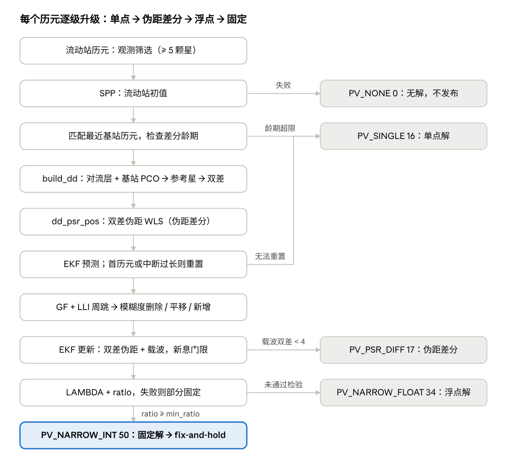

# RTK 解算处理逻辑 README

Nov 12, 2026 · @Haocheng Xu

`gnss_solver_node` 开启 RTK（`rtk.enable: true`）后，对每个流动站历元逐级尝试单点 → 伪距差分 → 浮点 → 固定，输出当前能达到的最高级别解。算法在 `RtkSolverPipeline`（`solver/rtk.hpp`、`src/solver/rtk.cpp`），模糊度搜索在 `solver/lambda.hpp`。

## 代码结构

```
gnss_solver_node（apps/gnss_solver_node.cpp：参数、发布、CSV、天空图）
├─ StreamWrapper                    stream/stream_wrapper.hpp
│   ├─ 原始数据 RawStream            stream/raw_stream.hpp
│   │   ├─ RosRawStream    online：订阅驱动或 ros2 bag 回放的话题
│   │   └─ RinexRawStream  offline：一次性读取流动站 RINEX 观测 + 导航文件
│   └─ 差分数据 CorrectionStream     stream/correction_stream.hpp：离线 RINEX 3.xx / RTCM 3.x 文件
└─ AlgorithmManager                 algorithm/algorithm_manager.hpp：星历/电离层缓存、观测筛选、调度
    ├─ SPPAlgorithmCore             algorithm/spp_algorithm_core.hpp
    └─ RTKAlgorithmCore             algorithm/rtk_algorithm_core.hpp：基站 ARP/PCO → RtkSolverPipeline
```

SPP 与 RTK 共用同一套筛选后的观测和星历，可以同时开启（`spp.enable`、`rtk.enable`）。

## 整体流程



左列是主流程，右列是每一级失败时的退化输出。EKF 状态跨历元保留；伪距差分失败不会中断滤波，只是无法用它重置滤波器。

## 输入与数据准备

两种模式的流动站数据来源不同，差分数据都来自离线文件：

| 模式 | 流动站观测与星历 | 差分数据 |
| --- | --- | --- |
| `online` | 订阅 `range_meas` / `ephem` / `glo_ephem` / `iono_params` / `receiver_lla`（驱动或 ros2 bag 回放），每收到一帧 `range_meas` 解算一个历元 | `correction.paths` 的离线文件 |
| `offline` | `offline.rover_obs_paths` / `offline.rover_nav_paths` 的 RINEX 文件，在独立线程中先送出全部星历和电离层参数，再按时间顺序送出观测；`offline.playback_rate` 为 0 时尽快处理 | 同上 |

1. **差分数据加载**（`CorrectionStream`）。
   - 在第一个可用的流动站历元到来时加载 `correction.paths` 的全部文件，因为 RTCM MSM 只含周内秒，需要用流动站时刻确定周数。加载失败只尝试一次，之后 RTK 不再输出。
   - `correction.format: auto` 时，文件名含 `.rtcm` 或以 `.rtc` 结尾按 RTCM，否则按 RINEX；也可以显式写 `rinex` / `rtcm3`。
   - **RINEX**：RINEX 3.xx 观测文件（`.crx` 需先用 crx2rnx 解压），可跨天堆叠多个文件。每个频段按优先级只保留一个信号（如 GPS L2 优先 L2L/L2S，尽量与 u-blox 流动站一致），读取 LLI，GLONASS 频率按头文件频道号修正。
   - **RTCM 3.x**（`src/rtcm/rtcm3.cpp`）：解码 MSM4/5/6/7（GPS/GLONASS/Galileo/BDS/QZSS）、1005/1006（ARP 坐标与天线高）、1007/1008/1033（天线型号）。信号选择与 RINEX 共用同一套优先级；载波 LLI 由锁定时间指示器减小或连续为 0 判定，半周未解决时载波不置半周有效位。GLONASS 频道号只能从 MSM5/7 获得。
   - 去掉空历元后按时间排序；一个历元都没读到，或没有基站坐标，则加载失败。
2. **基站历元匹配**。对每个流动站历元，用二分查找时间最近的基站历元，可以晚于流动站。HKWS 是 30 s 采样，匹配到的龄期不超过 15 s；是否可用由算法层的 `max_base_age_s` 判定。
3. **星历缓存**（`AlgorithmManager`）。同一 IODE 且同一 toe 的重复广播直接覆盖。online 每颗星保留最近 16 个版本；offline 一次性载入整天星历，不限版本数。解算时取有效期内（GLONASS 1800 s，其余 7200 s）toe 最近的版本，不健康则剔除。基站没有自己的星历，与流动站共用。
4. **流动站观测筛选**（SPP / RTK 共用）。保留同时满足以下条件的卫星：
   - 属于 GPS / GLONASS / Galileo / BDS / QZSS；
   - L1 类伪距有效，且所有卫星来自同一时刻（差异 ≤ 1 ms）；
   - 有健康星历，且 URA 权重可用；
   - 同一颗星只保留一次。

   少于 4 颗时整个历元跳过，少于 5 颗时不做 RTK。
5. **前置条件**。收到 8 参数电离层模型之前，所有历元都会被跳过。ENU 原点：online 取第一帧 `receiver_lla`，收到之前不发布结果；offline 取观测文件头的 APPROX POSITION，没有时取第一个解。

**基站坐标与天线**（差分数据加载后由 `RTKAlgorithmCore::initialize` 一次性计算）：

1. **标石坐标**。优先用参数 `correction.base_ecef`（应为 IGS SINEX 等精确坐标）。未设置时用文件中的坐标：RINEX 为第一个文件头里的 APPROX POSITION，只有米级精度；RTCM 为 1005/1006 的 ARP 减去天线高。
2. **标石 → 天线参考点 ARP**。RINEX 读取 `ANTENNA: DELTA H/E/N`，RTCM 用 1006 的天线高作为 H，按当地 ENU 旋转到 ECEF 后加到标石上：ARP = marker + R\_enu→ecef·\[E, N, H\]ᵀ。HKWS 的 H = 0.0083 m。
3. **相位中心偏移 PCO**。
   - 设置 `correction.antex_path` 后，`antex2rcv_pco` 按天线型号加天线罩（HKWS 为 `LEIAR25.R4      LEIT`；RTCM 取 1033 等电文的天线描述符）在 ANTEX 中查各频率的 PCO（北、东、天），找不到时退到天线罩为 NONE 的条目。
   - 频率代码与（星座, 频段）的对应：G01/G02、R01/R02、E01/E07、C02/C07。缺少对应频率时，退用 GPS 同一频段的值。
   - PCO 转成 ECEF 偏移后传给 solver。不设置 `antex_path` 时不改正，只打印警告。

只改正基站天线；流动站的结果对应流动站天线的相位中心。广播星历本身就参考卫星天线相位中心，不需要卫星 PCO。

## 双差构建

`build_dd` 把两站观测变成双差伪距和双差载波，消去接收机钟差与卫星钟差，并大幅削弱轨道和大气误差。

$$
\nabla\Delta(\cdot)^{jr} = \left[(\cdot)^j_{rov} - (\cdot)^j_{base}\right] - \left[(\cdot)^r_{rov} - (\cdot)^r_{base}\right]
$$

1. **共视卫星**。
   - 两站都要有 L1 类伪距，因为发射时刻靠它估计；
   - GLONASS 只在 `use_glonass` 打开时参与。
2. **卫星状态**。复用 SPP 的 `sat_states`，分别按流动站、基站各自的发射时刻计算卫星位置与钟差。
   - 两站观测不同时（龄期最多 15 s），这段时间里卫星会移动，分开算就把这部分变化计入了。
   - 单差前先对两站分别改正卫星钟差和对流层：P' = P + c·δt^i − T。对流层 T 用 calculate\_trop\_delay 计算，流动站取近似位置和它处的高度角，基站取 ARP 的经纬高和基站处的高度角。两站高差大或低仰角时，双差对流层残差可达厘米级。
3. **高度角筛选**。按流动站近似位置计算高度角：滤波器已初始化时用滤波位置，否则用 SPP 位置；低于 `elevation_cutoff_degree` 的卫星剔除。
4. **频段匹配**。频段 0 为 L1 / G1 / E1 / B1I，频段 1 为 L2 / G2 / E5b / B2I，按频率判定（容差 1 kHz）。两站都要有该频段的有效伪距（status bit0）。
5. **载波有效性与周跳**。
   - `cp_valid`：两站载波非零且半周已解决（status bit1 与 bit2）；GLONASS 各星波长不同，暂不构建载波双差。
   - `slip`：bit0 表示流动站周跳，bit1 表示基站周跳。这里先填 LLI，之后在 `solve` 中再并入 GF 的周跳结果。周跳单独标记，不影响 `cp_valid`，由 EKF 决定是否重置模糊度。
6. **分组与参考星**。按（星座, 频段）分组，QZSS 并入 GPS。每组取高度角最高的卫星作参考星，其余卫星与它作差；少于 2 颗的组丢弃。

每个 `DdMeasurement` 保存以下内容：

- 卫星对、星座和频段、波长；
- 流动站侧两颗星的位置；
- 基站几何单差 ρ\_b^j − ρ\_b^r（含 Sagnac，取到该频段的相位中心 ARP + PCO）；
- 双差伪距和双差载波（单位 m）；
- 定权系数 1/sin²E；
- 两颗星各自的站间单差和周跳标志。

基站坐标已知，所以基站侧的几何单差是常数。流动站侧的几何距离在解算时用当前位置重算。

## 伪距差分

`dd_psr_pos` 只用双差伪距解位置，得到 DGNSS 解。它有两个用途：一是 EKF 初始化或重置时的初值，二是载波不可用时的输出。

**观测模型**。只估 3 维位置，双差后没有钟差状态：

$$
\hat{y}_i(\mathbf{r}) = \left[\rho(\mathbf{r}^{j}, \mathbf{r}) - \rho(\mathbf{r}^{r}, \mathbf{r})\right] - (\rho_b^j - \rho_b^r), \qquad \frac{\partial \hat{y}_i}{\partial \mathbf{r}} = -(\mathbf{e}^j - \mathbf{e}^r)^\mathsf{T}
$$

**双差协方差**。单站非差方差取 σ²/sin²E。站间单差把两站的方差相加，得到系数 2。同一组里的所有双差共享参考星 r，所以协方差不是对角阵：

$$
R_{ii} = 2\sigma_P^2\left(\frac{1}{\sin^2 E_j} + \frac{1}{\sin^2 E_r}\right), \qquad R_{ik} = 2\sigma_P^2\,\frac{1}{\sin^2 E_r} \;\;(i, k \text{ 同组})
$$

**求解**。权阵取 W = R⁻¹，初值是 SPP 位置，用与 SPP 相同的 Gauss–Newton 迭代（残差为预测值−观测值）：

$$
\delta\mathbf{r} = -\left(\mathbf{J}^\mathsf{T}\mathbf{W}\mathbf{J}\right)^{-1}\mathbf{J}^\mathsf{T}\mathbf{W}\,\mathbf{b}, \qquad \mathrm{Cov}(\hat{\mathbf{r}}) = \left(\mathbf{J}^\mathsf{T}\mathbf{W}\mathbf{J}\right)^{-1}
$$

- 双差少于 4 个时不求解。
- 迭代上限为 `max_iterations`（默认 10），收敛阈值为 1e-4 m；未收敛时视为失败，退回 SPP。
- 法方程用 LDLT 分解求解。

## 浮点 EKF

EKF 跨历元保留位置、速度和单差模糊度，用双差伪距和双差载波联合更新。载波双差通过检验的不少于 4 个时，输出浮点解。流动站历元必须按时间顺序输入。

### 状态

$$
\mathbf{x} = \begin{bmatrix} \mathbf{r}_r^\mathsf{T} & \mathbf{v}_r^\mathsf{T} & N_{1} & \cdots & N_{m} \end{bmatrix}^\mathsf{T}
$$

- r\_r 为位置（ECEF，m），v\_r 为速度（m/s）。
- N\_k 是每颗卫星、每个频段的**站间单差**模糊度，单位是周，键为（卫星, 频段），状态维数随可见卫星动态增减。
- 用单差而不是双差作状态，是为了让参考星切换时不必转换模糊度；单差模糊度的公共部分不可观，只有双差 N\_j − N\_r 有意义。

### 重置与预测

- **重置**：首历元、时间倒退、或历元间隔超过 `max_gap_s` 时触发。位置与协方差取伪距差分解；速度置零，方差为 (10 m/s)²；清空模糊度，连续固定计数和 hold 标志清零。没有伪距差分解时无法重置，只输出 SPP。
- **发散保护**（量测更新之后检查，触发时同样重置，本历元输出伪距差分/单点解）：
  - 浮点位置与本历元伪距差分解相差超过 `reset_pos_diff_m`（默认 30 m），且连续 `reset_diverge_epochs`（默认 5）个历元都超限（单历元的伪距差分解在城市多路径下可能偏几十米，不能据此立即重置）；伪距差分不可用时与 SPP 比较，门限放宽为 `reset_spp_diff_m`（默认 300 m，SPP 在城市峡谷可偏上百米）。此时按伪距差分解重置，没有伪距差分解时用 SPP 位置、(10 m)² 方差重置。
  - 参与更新的载波双差少于 `reset_min_phase_dd`（默认 5），且持续超过 `reset_low_phase_s`（默认 10 s）。
- 浮点停滞恢复：载波双差不少于 `stall_min_phase_dd`（默认 8），却连续 `stall_reset_s`（默认 30 s）固定不上时，只清空模糊度、保留位置和速度，并在位置协方差上加一份伪距差分协方差（不可用时加 1 m²）。这对应浮点模糊度带着伪距多路径偏差收敛、协方差过小、ratio 停在 1 附近的情况；此时位置偏差只有分米级，碰不到上面的重置条件。
- **预测**：匀速模型 r ← r + v·Δt。过程噪声按白噪声加速度离散化，每个轴独立，q\_a = `accel_std_mps2`²；模糊度对角元加随机游走 `amb_process_std_cycles`²·Δt。

$$
\mathbf{Q}_{rv} = q_a\begin{bmatrix} \Delta t^3/3 & \Delta t^2/2 \\ \Delta t^2/2 & \Delta t \end{bmatrix} \otimes \mathbf{I}_3
$$

### GF 周跳探测

双频无几何组合消去了几何距离、钟差和对流层，只剩电离层和模糊度，相邻历元本应只缓慢变化：

$$
GF = \lambda_1\phi_1 - \lambda_2\phi_2 = -(I_1 - I_2) + \lambda_1 N_1 - \lambda_2 N_2, \qquad |GF(t_k) - GF(t_{k-1})| > \tau \;\Rightarrow\; \text{周跳}
$$

- τ = `gf_slip_threshold_m`（默认 0.05 m）。两个频段的载波都有效且半周已解决时才计算 GF；缺一个频段时清掉该星的记录。
- 流动站每个历元都与上一历元比较，间隔超过 `max_gap_s` 时只更新记录、不比较。
- 基站只在切换到新的基站历元时，与上一个基站历元比较，间隔上限为 2 × `max_base_age_s`。
- GF 的周跳结果和 LLI 并到同一个周跳标志里：bit0 流动站、bit1 基站。一颗星发生周跳时，两个频段的模糊度都会被重置。
- 低纬度电离层活跃时，30 s 的基站间隔内 GF 可能变化数厘米，误判多时把 τ 放宽到 0.1 m。

### 模糊度管理（每历元更新前）

1. **删除**。以下两种模糊度状态会被删除：
   - 连续 `max_amb_outage_s` 秒没有有效载波的；
   - 发生周跳的。周跳来自 LLI 或 GF。流动站的周跳立即生效；基站的周跳只在基站历元切换的那一历元生效，因为同一个基站历元会被多个流动站历元复用。
2. **相位-伪距一致性校正**。接收机钟差的漂移，以及每次切换基站历元时的钟差跳变，会让同一组的单差模糊度整体偏移（双差中抗消）。按（星座, 频段）计算平均偏移，把已有状态整体平移过去，让新旧模糊度的公共部分一致：

   $$
   \Delta_g = \frac{1}{n_g}\sum_{k \in g}\left[\frac{SD_{\phi,k} - SD_{P,k}}{\lambda_k} - N_k\right], \qquad N_k \leftarrow N_k + \Delta_g
   $$
3. **新增**。新出现的（卫星, 频段）用 N = (SD\_φ − SD\_P)/λ 初始化，方差为 `amb_init_std_cycles`²，与其它状态不相关。

### 量测更新

每个双差产生一行伪距；载波有效，且两颗星都有模糊度状态时，再加一行载波：

$$
\nabla\Delta P = \nabla\Delta\rho(\mathbf{r}_r) + \varepsilon_P, \qquad \nabla\Delta\phi\,\lambda = \nabla\Delta\rho(\mathbf{r}_r) + \lambda\,(N_j - N_r) + \varepsilon_\phi
$$

- **雅可比**：位置列为 −(e^j − e^r)ᵀ；载波行在 N\_j 处为 +λ、在 N\_r 处为 −λ。
- **协方差**：结构与伪距差分相同，只在同类型、同组的行之间共享参考星项。非差方差在 σ² 之外还加了基线比例项，b 为当前基线长度：

$$
\sigma^2_{0} = 2\left[\sigma_{P/\phi}^2 + \left(\mathrm{ppm}\times10^{-6}\, b\right)^2\right]
$$

- **新息门限**：用先验 S 的对角元检验 |y\_i| > k·√S\_ii（k = `innov_gate_sigma`）。超限的行不参与更新；超限的是载波行时，当作周跳，在更新后删除该星（非参考星）的模糊度，下一历元重新初始化。
- **更新**：标准 EKF，K = PHᵀS⁻¹（LDLT 求解）。协方差用 Joseph 形式 P = (I − KH)P(I − KH)ᵀ + KRKᵀ，保持对称正定。

## 模糊度固定

每个历元都对本历元参与更新的双差模糊度做 MLAMBDA 搜索。所有模糊度一起固定失败时，再试部分固定。ratio 不小于 `min_ratio`、且固定解的载波残差检验通过时输出固定解；开启 `fix_and_hold` 且连续固定达到 `hold_min_fix_epochs` 个历元后，才把固定的整数双差约束回滤波器。

1. **单差 → 双差**。用矩阵 D 从状态中取出双差模糊度。D 每行对应一个载波双差：在本星处为 +1，在参考星处为 −1。

   $$
   \hat{\mathbf{a}} = \mathbf{D}\hat{\mathbf{x}}, \qquad \mathbf{Q}_{\hat{a}} = \mathbf{D}\mathbf{P}\mathbf{D}^\mathsf{T}
   $$
2. **数量检查**。双差模糊度少于 `min_fix_dd` 个时不尝试固定，ratio 记为 0。
3. **MLAMBDA**（`lambda.hpp`）。先做 LD 分解 Q = LᵀDL，再用整数 Z 变换降相关（整数高斯变换加排序），最后在降相关空间做收缩椭球深度优先搜索，取最优和次优两组整数解。实现参考 Chang 2005 和 RTKLIB `lambda.c`（BSD-2）。

   $$
   s_k = (\hat{\mathbf{a}} - \check{\mathbf{a}}_k)^\mathsf{T}\mathbf{Q}_{\hat{a}}^{-1}(\hat{\mathbf{a}} - \check{\mathbf{a}}_k), \qquad \mathrm{ratio} = s_2 / s_1
   $$
4. **ratio 检验**。ratio < `min_ratio`（默认 3）时进入部分固定（见下文），仍失败则保留浮点解。Q 非正定或搜索超过 10000 步，也算本次搜索失败。
5. **固定解回代**。用最优整数解 ǎ 修正位置块 b 及其协方差：

   $$
   \check{\mathbf{b}} = \hat{\mathbf{b}} - \mathbf{P}_{\hat{b}\hat{a}}\mathbf{Q}_{\hat{a}}^{-1}(\hat{\mathbf{a}} - \check{\mathbf{a}}), \qquad \mathbf{P}_{\check{b}} = \mathbf{P}_{\hat{b}} - \mathbf{P}_{\hat{b}\hat{a}}\mathbf{Q}_{\hat{a}}^{-1}\mathbf{P}_{\hat{a}\hat{b}}
   $$

   其中 P\_ba = P\_{r,·}Dᵀ，是位置与双差模糊度的互协方差。
6. **残差检验**（`fix_validate_sigma`）。用固定位置 b̌ 和整数解 ǎ 计算每个参与固定的双差载波残差，任一超过 k·σ（k 默认 4，σ 与量测更新中该载波行的标准差相同）即拒绝这组固定，按部分固定继续剔除：

   $$
   v_i = \nabla\Delta\phi_i\,\lambda_i - \nabla\Delta\rho_i(\check{\mathbf{b}}) - \lambda_i\,\check{a}_i, \qquad |v_i| \le k\,\sigma_i
   $$

   hold 之后浮点模糊度已经被整数约束，Q 很小，ratio 会虚高到 10⁸ 量级，失去检验意义；残差检验直接看原始载波观测，不受 hold 影响。

**部分模糊度固定（`par_enabled`）**

- 候选双差按本星的定权系数 1/sin²E 排序，高度角低的排在前面。
- 所有模糊度一起固定失败后，每次剔除一个高度角最低的双差，重新构造 D、做 LAMBDA，直到 ratio 通过，或剩余个数少于 max(`min_fix_dd`, ⌈`par_min_fix_fraction`·候选数⌉)。只剩少数双差时 ratio 容易通过，残差检验又只覆盖参与固定的双差，误固定很难发现，所以要限制剔除比例。
- 固定成功时，`ratio` 取通过的那一组的值，`num_fix_dd` 记录固定的个数。失败时，`ratio` 报告所有模糊度一起搜索时的值。

**fix-and-hold（`fix_and_hold`）**

固定成功后，把固定的整数双差 ǎ 作为伪观测，再做一次 EKF 更新：

$$
\check{\mathbf{a}} = \mathbf{D}\mathbf{x} + \mathbf{v}, \qquad \mathbf{v} \sim \mathcal{N}(\mathbf{0},\, \sigma_{hold}^2\mathbf{I}), \qquad \sigma_{hold} = \texttt{hold\_std\_cycles} = 10^{-3}\text{ 周}
$$

- 更新后，滤波器里的模糊度和位置都贴近固定解，后续历元在此基础上继续，固定会更连续。
- 代价是误固定一旦被 hold，就会持续保持。为此做了两层保护：
  - 连续固定达到 `hold_min_fix_epochs`（默认 10）个历元才开始 hold，任一历元未固定则计数清零，避免单次误固定被立刻锁住；
  - hold 过的滤波器若某历元做了搜索却没有通过 ratio / 残差检验，认为锁住的整数可能是错的，清空全部模糊度（保留位置、速度），从浮点重新收敛。
- `hold_std_cycles` 默认 1e-3 周很紧，RTKLIB 对应约 0.03 周；误固定仍多时可放宽到 0.03，或关掉 `fix_and_hold`。

## 输出

每个历元输出当前能达到的最高级别解，解类型沿用 NovAtel BESTPOS 的 `PV_*` 编码。

| pos\_type | 解类型 | 条件 | NavSatFix status | 协方差 |
| --- | --- | --- | --- | --- |
| 50 `PV_NARROW_INT` | 固定解 | 浮点解可用，双差模糊度数≥ `min_fix_dd`，且 ratio ≥ `min_ratio` | GBAS\_FIX (2) | 回代后的 P\_b |
| 34 `PV_NARROW_FLOAT` | 浮点解 | 通过检验的载波双差 ≥ 4 | GBAS\_FIX (2) | EKF 位置块 |
| 17 `PV_PSR_DIFF` | 伪距差分 | 双差伪距 ≥ 4 且收敛 | GBAS\_FIX (2) | (JᵀWJ)⁻¹ |
| 16 `PV_SINGLE` | 单点 | 龄期超限、共视星不足或双差失败 | FIX (0) | UNKNOWN |
| 0 `PV_NONE` | 无解 | SPP 失败 | 不发布 | — |

**话题**（ros\_cfg 的 `publish.rtk.*` 与 `publish.reference_lla`）：

- `rtk/fix`：NavSatFix，协方差为 ENU 顺序，由 Rᵀ Cov\_ECEF R 转换得到。
- `rtk/ecef`、`rtk/enu`：PointStamped。
- `gnss/reference_lla`：ENU 原点，transient\_local，SPP 与 RTK 共用。

时间戳由 GPST 转成 UTC Unix 时间。

**CSV**（`output_path/<启动时刻 YYYY-MM-DD_HH_MM_SS>/`，文件名前缀 `rtk_enu`；开启 SPP 时同目录还有 `spp_enu`）的列：

```csv
timestamp,x,y,z,lat,lon,alt,pos_type,num_dd_psr,num_dd_cp,base_age_s,ratio,num_fix_dd,std_e_m,std_n_m,std_u_m
```

- x / y / z 是 ENU 坐标（m）；lat / lon 保留 9 位小数。
- `num_dd_cp` 是通过新息检验、参与更新的载波双差个数。
- `base_age_s` 是流动站时刻减去基站时刻，可为负。
- `num_fix_dd` 是固定的双差模糊度个数，部分固定时小于 `num_dd_cp`，未固定为 0。
- 单点解的 std 列为 NaN。

统计固定率只需统计 pos\_type = 50 的行占比。

## 参数表

下表是 `config/alg_cfg.yaml` 中 `gnss_solver_node` 段与 RTK 相关的参数：算法参数在 `rtk.` 下，差分数据参数在 `correction.` 下。节点启动时校验取值范围，越界直接抛异常。模式与 SPP 参数见表后。

| 参数 | 默认值 | 单位 | 作用 | 调参建议 |
| --- | --- | --- | --- | --- |
| `rtk.enable` | true | — | 是否运行 RTK；关闭时不加载差分数据 | — |
| `rtk.elevation_cutoff_degree` | 15.0 | deg | 截止高度角，RTK 内部的 SPP 初值共用 | 城市环境可提高到 20 |
| `rtk.num_bands` | 2 | — | 双差频段数：1 只用 L1 类，2 再加 L2 类 | 双频接收机保持 2；GF 周跳探测需要 2 |
| `rtk.use_glonass` | false | — | GLONASS 参与伪距双差（载波始终不用） | 频间偏差未处理，保持 false |
| `rtk.code_std_m` | 0.3 | m | 天顶方向非差伪距标准差 | u-blox 可取 0.3–1.0；HKUST 城市数据 alg_cfg 用 1.0 |
| `rtk.phase_std_m` | 0.003 | m | 天顶方向非差载波标准差 | 新息频繁超限时取 0.005 |
| `rtk.max_base_age_s` | 30.0 | s | 最大差分龄期 | 实时 RTK 应 ≤ 5 |
| `rtk.baseline_std_ppm` | 1.0 | ppm | 与基线长度成正比的非差误差 | 12.9 km 基线可取 2–3 |
| `rtk.accel_std_mps2` | 3.0 | m/s² | 匀速模型白噪声加速度 | 车载 1–5，手持/静态取小 |
| `rtk.amb_init_std_cycles` | 10.0 | 周 | 新模糊度初值标准差 | 一般不动 |
| `rtk.amb_process_std_cycles` | 1.0e-4 | 周/√s | 模糊度随机游走 | 一般不动 |
| `rtk.innov_gate_sigma` | 5.0 | σ | 新息门限 | 误剔多时调大 |
| `rtk.max_gap_s` | 10.0 | s | 历元间隔超过时重置滤波器 | — |
| `rtk.max_amb_outage_s` | 10.0 | s | 模糊度连续未观测超过时删除 | — |
| `rtk.gf_slip_threshold_m` | 0.05 | m | GF 相邻历元跳变超过时判为周跳 | 低纬电离层活跃时放宽到 0.1 |
| `rtk.min_ratio` | 3.0 | — | LAMBDA ratio 阈值，≥ 1 | 误固定多时提高 |
| `rtk.min_fix_dd` | 5 | 个 | 参与固定的最少双差模糊度数，也是部分固定的下限 | — |
| `rtk.par_enabled` | true | — | 全集失败时按高度角从低到高剔除再试 | — |
| `rtk.par_min_fix_fraction` | 0.9 | — | 部分固定至少保留候选双差的比例 | 固定率过低时降到 0.8；HKUST 数据中 ≤0.7 时误固定约 90% |
| `rtk.fix_and_hold` | true | — | 固定后把整数双差约束回滤波器 | 误固定多时先关掉 |
| `rtk.hold_std_cycles` | 1.0e-3 | 周 | fix-and-hold 伪观测标准差 | 想让约束弱一些可取 0.01–0.03 |
| `rtk.hold_min_fix_epochs` | 10 | 历元 | 连续固定达到该数才开始 hold | 误固定多时调大 |
| `rtk.fix_validate_sigma` | 4.0 | σ | 固定解载波残差检验门限 | 拒绝过多时调大到 5 |
| `rtk.reset_pos_diff_m` | 30.0 | m | 浮点与伪距差分（或 SPP）相差超过的门限 | 城市峡谷 SPP 粗差大时调大 |
| `rtk.reset_diverge_epochs` | 5 | 历元 | 连续超过 `reset_pos_diff_m` 达到该数才重置 | — |
| `rtk.reset_spp_diff_m` | 300.0 | m | 伪距差分不可用、改与 SPP 比较时的门限 | — |
| `rtk.psr_outlier_sigma` | 4.0 | σ | 双差伪距定位的粗差剔除门限（最多剔 1/3，至少留 5 个） | — |
| `rtk.reset_min_phase_dd` | 5 | 个 | 载波双差不足的判定门限 | — |
| `rtk.reset_low_phase_s` | 10.0 | s | 载波双差不足持续超过该时长时重置 | — |
| `rtk.stall_min_phase_dd` | 8 | 个 | 浮点停滞判定所需的最少载波双差 | — |
| `rtk.stall_reset_s` | 30.0 | s | 连续该时长未固定时清空模糊度 | 重初始化过于频繁时调大到 60 |
| `correction.format` | auto | — | auto / rinex / rtcm3 | 文件名不规范时显式指定 |
| `correction.paths` | HKWS 013/014 | 路径 | 基站 RINEX 或 RTCM 文件列表，支持 `~/`；第一个文件提供测站与天线信息 | 数据跨天时两天都要加 |
| `correction.base_ecef` | HKWS APPROX XYZ | m | 基站标石 ECEF，覆盖文件中的坐标，再换算到 ARP；删掉此行则用文件中的坐标 | **需换成 IGS SINEX 精确坐标** |
| `correction.antex_path` | "" | 路径 | IGS ANTEX 文件，用于基站天线 PCO；空字符串不改正 | 2021 年数据用 igs14.atx |
| `output_path` | \~/gnss\_comm\_output | 路径 | SPP / RTK 的 CSV 输出根目录，每次启动在其下新建一个本地时间命名的子目录；空字符串关闭 | — |

迭代参数 `max_iterations` = 10 和 `convergence_threshold` = 1e-4 m 仅用于伪距差分，没有开放为 ROS 参数。

其它参数：

| 参数 | 默认值 | 作用 |
| --- | --- | --- |
| `mode` | online | online / offline；launch 的 `mode` 参数会覆盖 |
| `offline.rover_obs_paths` | 占位路径 | 流动站 RINEX 观测文件列表，offline 必填 |
| `offline.rover_nav_paths` | 占位路径 | 流动站 RINEX 导航文件列表，offline 必填；目前只接受 RINEX 3.04 |
| `offline.playback_rate` | 0.0 | 0 尽快处理；> 0 按观测间隔 / rate 节流，单步最多等 1 s |
| `spp.enable` | true | 是否运行 SPP |
| `spp.elevation_cutoff_degree` / `spp.max_iterations` / `spp.convergence_threshold` | 15.0 / 30 / 1e-4 | 独立 SPP 的参数 |

## 使用方法与已知限制

### 使用

1. **解压基站文件**：把 `.crx` 转成 `.rnx`。本机当前没有 `crx2rnx`，可用 `pip install hatanaka` 安装（它自带 `crx2rnx` 命令），或从 GSI 的 RNXCMP 源码编译。

   ```bash
   cd /home/yjh/happy_room/vins_ws/bags/base_station && crx2rnx HKWS00HKG_R_20210130000_01D_30S_MO.crx && crx2rnx HKWS00HKG_R_20210140000_01D_30S_MO.crx
   ```
2. **编译**：

   ```bash
   cd /home/yjh/happy_room/vins_ws && colcon build --packages-select gnss_comm && source install/setup.bash
   ```
3. **启动**：SPP / RTK 的开关在 alg\_cfg 的 `spp.enable` / `rtk.enable`，RViz 中 RTK 轨迹为绿色、SPP 为白色。
   - online：启动后按提示输入 bag 路径，回放延迟 3 s，后续可继续输入下一个 bag。

     ```bash
     ros2 launch gnss_comm gnss_solver.launch.py mode:=online
     ```
   - offline：先在 alg\_cfg 填好 `offline.rover_obs_paths` / `offline.rover_nav_paths`，节点直接读文件，处理完后保持运行，Ctrl-C 退出。

     ```bash
     ros2 launch gnss_comm gnss_solver.launch.py mode:=offline
     ```

### 已知限制

| 限制 | 影响 | 改进方向 |
| --- | --- | --- |
| 基站标石坐标用 RINEX 头 APPROX POSITION | 固定解整体偏移米级 | 换成 IGS SINEX 周解坐标 |
| `antex_path` 默认为空 | 基站 PCO 不改正，L1/L2 相位中心差厘米级 | 下载 igs14.atx 并填入路径 |
| 未改正天线 PCV，也未改正流动站天线 | 随高度角变化的毫米级误差；结果对应流动站相位中心 | 读取 ANTEX 的 NOAZI 行；标定 u-blox 天线 |
| 对流层只用模型，未估计天顶延迟残差 | 两站天气差异大时仍有厘米级残差 | 长基线时把流动站 ZTD 残差加入状态 |
| 基站 30 s 采样，取最近历元，不插值 | 龄期最多 15 s，双差大气残差增大 | 前后历元插值，或换 1 s 基站数据 |
| 基线 12.9 km，未处理电离层 | 双差电离层残差厘米级，固定率受限 | 调大 `baseline_std_ppm`；估计双差电离层 |
| GF 阈值固定，不随间隔和高度角调整 | 低纬电离层活跃时可能误判周跳，频繁重置模糊度 | 阈值随间隔和高度角缩放；加 MW 组合交叉检验 |
| fix-and-hold 仍可能保持误固定 | 连续多历元误固定且残差都在门限内时仍会被锁住 | 用独立的未 hold 滤波器计算 ratio；加入 MW 组合辅助验证 |
| GLONASS 不参与载波 | 可用卫星少一个星座 | 估计频间偏差，或采用 GLONASS 单差模糊度的方案 |
| 两站信号码不一致（如 L2C 对 L2W）时未改正 1/4 周 | 该星模糊度无法固定到整数 | 比对 `code` 字段并改正相位偏差 |
| 流动站导航文件只支持 RINEX 3.04 | offline 模式无法直接用 3.02 等版本的导航文件（如 HKWS） | 放宽 `rinex2ephems` / `rinex2iono_params` 的版本检查 |
| RTCM 只解码 MSM4~7 | 传统观测电文 1001~1012 不可用；只有 MSM4/6 时丢弃 GLONASS | 补充传统电文解码；从 1020 星历取 GLONASS 频道号 |
| 差分数据只支持离线文件，且只加载一次 | 无法接 NTRIP 实时流；加载失败需重启节点 | 增加订阅 `RtcmMsg` 的 CorrectionStream |
| 从未编译和用数据验证 | 参数和固定率未知 | 先用 RTKLIB rnx2rtkp 跑同一份数据作对照 |
